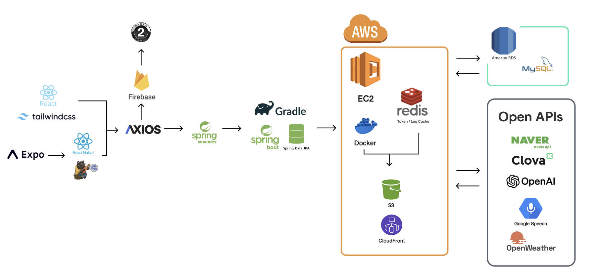
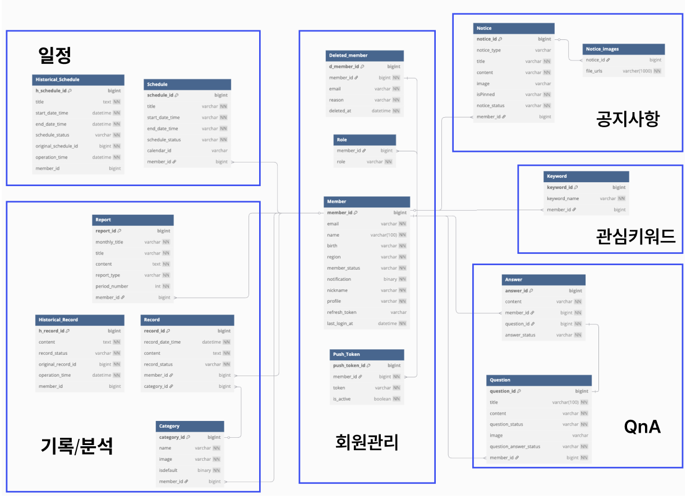
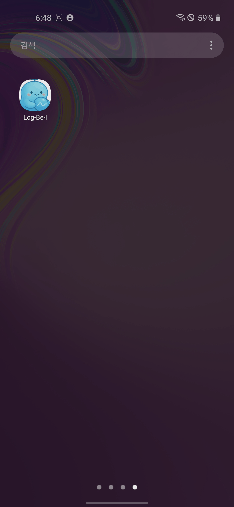
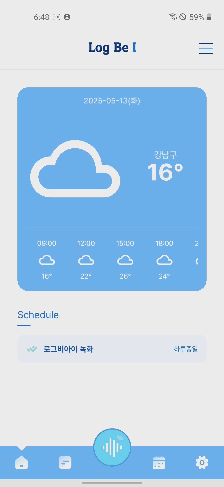
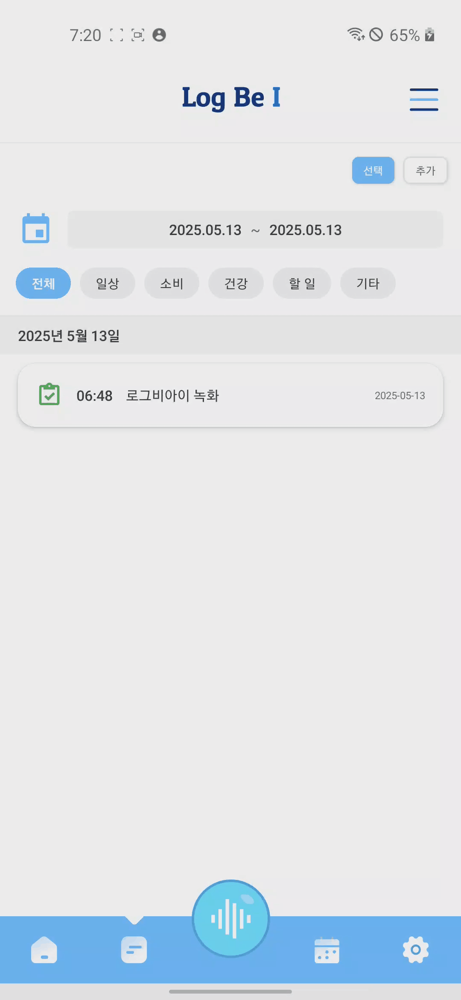
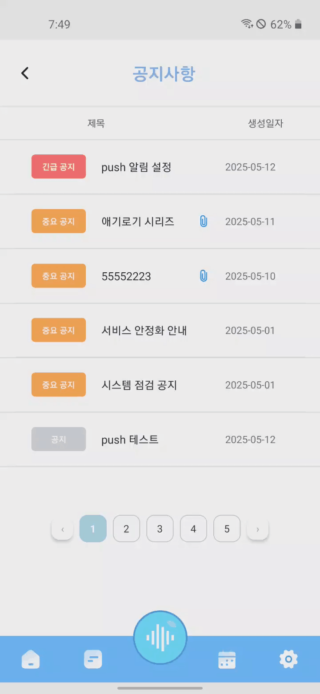
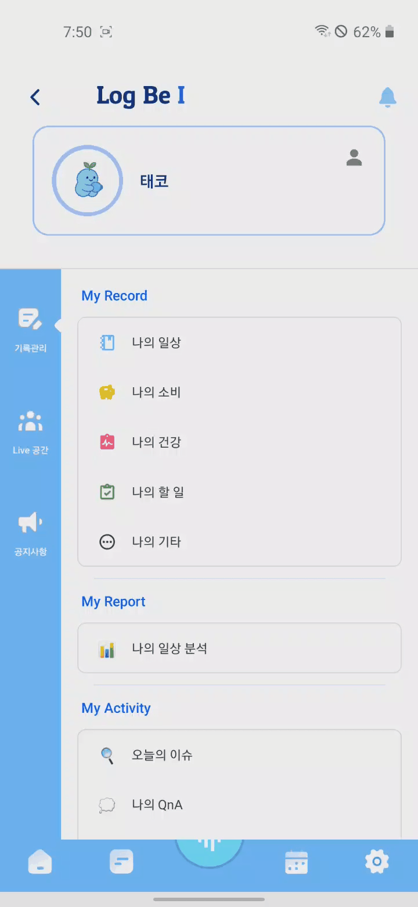
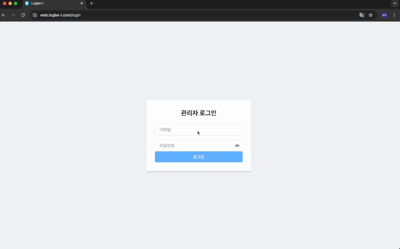
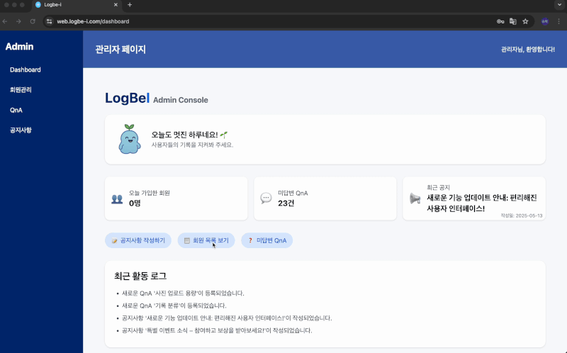
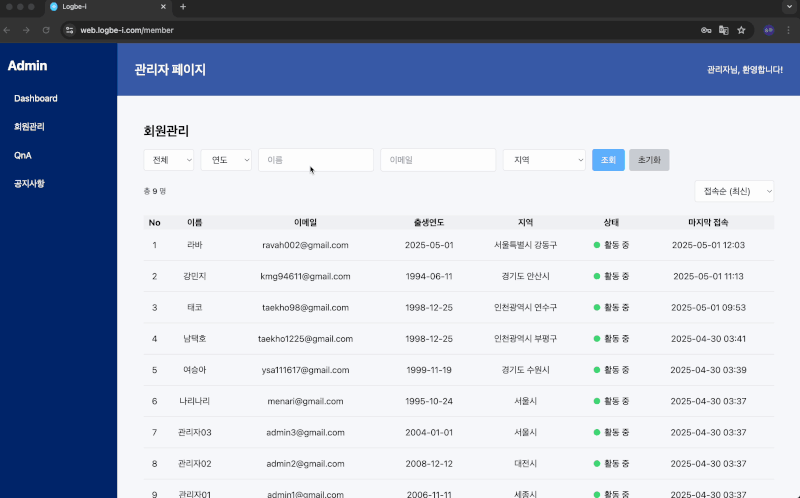

# Log-Be-I

## 프로젝트 소개

- 일상 기록과 분석을 위한 모바일 애플리케이션
- Android 전용 앱
- React Native/Expo 기반 개발
- Naver CLOVA API, OpenAI - ChatGPT, Google TTS을 활용하였습니다.
- 개발 기간 : 2025.04.02 ~ 05.01
- 배포: EAS Build를 통한 APK 파일 배포(스토어 미배포)
- Repo : https://github.com/Log-Be-I

## 🤝 팀원 구성

| 강민지[팀장] | 구본석 | 남택호                                                 | 여승아                                                 |
|--|--|-----------------------------------------------------|-----------------------------------------------------|
|  |  |  |  |
| [@KangMinJi](https://github.com/minggiK) | [@6feetlife](https://github.com/6feetlife) | [@NamTaekHo](https://github.com/NamTaekHo)          | [@YeoSeungA](https://github.com/YeoSeungA )         |

## 🏗️ 프로젝트 아키텍처
  

## 🔧 Development Setup

### Frontend

- **Languages / Frameworks**: JavaScript, React Native, React, Expo
- **State Management**: Zustand
- **Networking**: Axios
- **Styling**: StyleSheet, Tailwind CSS
- **Build & Deployment**: EAS, Expo Go

### Backend

- **Language / Framework**: Java 11, Spring Boot
- **Security & Auth**: Spring Security, Google OAuth 2.0, JWT
- **Database**: MySQL (RDS), Redis (Token / Log), Spring Data JPA
- **Build Tool**: Gradle
- **API Docs**: Swagger

### DevOps / Infra

- **Cloud**: AWS EC2, S3, RDS
- **Container**: Docker
- **CI/CD**: GitHub Actions
- **IDE**: IntelliJ, VSCode

### External APIs / AI

- **AI**: OpenAI GPT (분석/요약), CLOVA CSR (STT), Google TTS
- **Integration**: Naver News API, OPENWEATHER API

### Tools

- **Version Control**: GitHub
- **Communication / Docs**: Discord, Notion
- **Design Tool**: Figma

## 🛠 기술 스택

  <!-- Frontend -->
  
  
  
  
  
  
   

  <!-- State Management & API -->
  
  
   

  <!-- Auth -->
  
   

  <!-- Backend -->
  
  
  
  

  
  
  
   

  <!-- AI / API -->
  
  
  
  
  
   

  <!-- Infra & DevOps -->
  
  
  
  
  
  
   

  <!-- 협업 도구 -->
  
  
  
  
   

  <!-- IDE -->
  
  

### ERD

 

## 🚩 서비스 구현 기능
### 📱 주요 기능(App)

| 앱 실행                                              | 로그인                                             |
|---------------------------------------------------|-------------------------------------------------|
|  |  |

| 회원가입 | 메인화면, 날씨 상세 조회                                    |
|------|---------------------------------------------------|
| 내용1  |  |

| 사이드바, 분석 브리핑                                                      | 음성 기록                                                  |
|-------------------------------------------------------------------|--------------------------------------------------------|
|  |  |

| 기록 수정                                                   | 기록 조회, 삭제                                                      |
|---------------------------------------------------------|----------------------------------------------------------------|
|  |  |

| 텍스트 기록                                                    | 공지 조회                                                 |
|-----------------------------------------------------------|-------------------------------------------------------|
|  |  |

| 캘린더(일정)                                                | 이슈카드                                            |
|--------------------------------------------------------|-------------------------------------------------|
|  |  |

| 마이페이지                                            | Push 알림                                                     |
|--------------------------------------------------|-------------------------------------------------------------|
|  |  |

### 🖥️ 주요 기능(Web)

| 로그인 |  |
|--------------|---------------------------------------------------------------------------------------------------|
| 메인페이지 |                                                            |
| 회원 조회 |  |
| QnA 필터링 |                                                        |
| QnA 답변 생성 |  |
| QnA 답변 수정 |                                                               |
| QnA 답변 삭제 |  |
| 공지사항 조회 및 수정 |                                                               |
| 공지사항 삭제 |  |

## 📌 주요 기능 
### 1. 일상 기록

- 텍스트 기록
    - 카테고리별 일상 기록
    - 시간, 날짜, 내용 기록
    - 기록 관리 및 조회
- 음성 기록 (STT)
    - 마이크 권한 관리
    - 음성 녹음 시작/중지
    - 녹음 파일 저장 및 관리
    - 서버로 음성 파일 업로드
    - 음성 파일 변환 (STT)

### 2. 일상 분석

- 데이터 분석
    - 기록된 데이터 분석
    - 감정 비율 분석
    - 카테고리별 통계
- 음성 재생 (TTS)
    - 분석 결과 음성 재생
    - 음성 파일 재생 제어
    - 재생 상태 관리

### 3. 일정 관리

- 캘린더 기능
    - 캘린더 기반 일정 관리
    - 일정 추가/수정/삭제
    - 공휴일 표시

### 4. 알림 기능

- 알림 설정 관리
- 알림 권한 관리

### 5. 기타 기능

- QnA
    - 사용자 문의 작성
    - 문의 답변 확인
    - 문의 상태 관리
- 공지사항
    - 중요 공지 상단 표시
    - 공지사항 목록 조회
    - 첨부파일 등록
- 프로필 관리
    - Google 로그인
    - 닉네임 설정
    - 생년월일 설정
    - 지역 설정
    - 계정 삭제

## 👥 구성원 별 담당 내용
### 강민지

[일상 분석, OpenAI GPT API, 관리자 웹페이지 기능, 테스트 코드]

> ### 일상 분석 [BE]
- 사용자 기록 기반 자동 분석 시스템 설계 및 구현 
- 매주 월요일 / 매월 1일 자동 실행되는 스케줄러를 통해 주간 및 월간 기록 데이터를 수집하고 분석 결과를 자동 생성 및 DB에 저장
- OpenAI GPT API를 활용해 사용자의 텍스트 기록을 기반으로 습관, 감정, 활동 패턴을 분석하고 개선 제안을 도출
- 프롬프트 설계를 통해 다음 항목을 정밀하게 추출하도록 구성:
  - 총 기록 횟수, 가장 많이 한 활동 
  - 감정 비율 (긍정/중립/부정)
  - 시간대 및 요일별 활동 패턴
  - 생활 습관 개선을 위한 제안
- OpenAI 응답 포맷을 단일 JSON 문자열로 받도록 설계하고, 줄바꿈/이스케이프/중첩 구조 이슈를 해결하기 위해 Jackson ObjectMapper 기반의 이중 파싱 및 JSON 문자열 escape 처리 로직 구현 
- 주간/월간 분석 생성 시 연도-월, 연도-주차 기준으로 분석 제목 자동 생성, 중복 저장 방지 
- 프롬프트 토큰 비용 절감을 위해 10명 단위로 배치 요청을 보내고 응답을 순차 처리하는 비동기 로직 구현
- 월간 리포트에는 카테고리별 활동 비율 및 시간대/요일별 활동 통계 추가 
- LocalDateTime 기반 기록 분석 기준일 처리에서 JV

> ### 관리자 웹 페이지 [BE]
- 관리자용 웹 대시보드 API 구현 : 신규 가입자 수, 미답변 QnA 수, 최근 공지사항 목록을 메인에 요약 제공하여 서비스 운영 현황을 빠르게 파악할 수 있도록 설계 
- 공지사항 작성 시 이미지/파일 첨부 가능하도록 구현, 첨부파일은 AWS S3에 업로드되며, 공지 글 삭제 시 관련 첨부파일은 90일 후 자동 삭제되도록 기능 구현

> ### 테스트 코드 [BE]
- Mockito 및 JUnit5 기반 단위 테스트 코드 작성 
- 핵심 도메인의 비즈니스 로직이 포함된 서비스 레이어에 대해 단위 테스트를 작성하고, 다양한 시나리오에서의 예외 및 조건 분기를 사전에 검증함으로써 코드 안정성 확보
- 인증 및 권한 관련 테스트에서는 SecurityContextHolder Mock하여 사용자 인증 정보를 설정하고, 실제 권한 흐름을 시뮬레이션함으로써 테스트의 일관성 확보
- 외부 API(OpenAI, CLOVA)는 Mock 처리하여 통합 테스트 비용 최소화

> ### 그 외 
- 로그비아이 프로젝트 아이디어 제시 
- MySQL RDS에서 UTC로 저장되던 시간 데이터를 KST로 일관되게 처리하기 위해 JDBC URL, JVM TimeZone, Jackson 설정을 통합적으로 조정
- LocalDateTime 역직렬화 기능 추가

### 구본석

[OAuth2.0, CLOVA CSR(STT), Google TTS, 로그 데이터 업로드 자동화, CI/CD, AWS CLOUD 관리] 
[음성 데이터 분석 및 분류 GPT Prompt 작성, Swagger, Test 코드 일부 작성]

> ### 음성 데이터 분석 및 분류 GPT promt 작성 [BE]

- 음성(STT) 데이터를 활용한 일상 기록 및 일정 분류 자동화 시스템 개발
  - voiceToText 활용하여 음성데이터를 text로 변환하여 GPT로 분석 요청
  - 작성된 prompt로 text 분석하여 기록 또는 일상으로 분류 이후 prompt에 작성된 형태로 데이터 반환 강제하여 db 저장
  - 잘못 분석된 text 또는 비어있는 (녹음된 소리가 없는) text파일 전달 받을시 예외 발생 로깆
  - 
> ### 로그 데이터 업로드 자동화 [BE]

- 로그 데이터 Redis-To-S3 자동화 프로세스 구축
  - 기능 단위로 로그를 그룹화하여 체계적인 관리 및 유지보수성 향상
  - S3로의 로그 데이터 전송 로직을 메서드화하여 코드 재사용성 증대
  - Spring Scheduler를 이용하여 주기적인 로그 이관 및 관리 자동화
  - Spring Actuator를 적용해 서버 재기동 없이 실시간 로그 레벨 조정 기능 제공

> ### AWS CLOUD 관리 & git Actions CI/CD 배포 자동화 [BE]

- AWS EC2, S3(Image 저장용, 로그 저장용)
  - 배포를 위한 EC2 환경 구성 및 redis 관리
  - 도메인 연결 및 HTTPS 적용으로 보안 및 안정성 강화
  - 이미지 및 log 데이터 저장용 S3 데이터 생명주기 관리 및 삭제 데이터 분리하여 임시보관 형태로 관리
  - AWS EC2 인스턴스, IAM 권한 및 보안 그룹 구성
- Git Actions/Docker를 활용한 CI/CD 배포 자동화 구현
  - 코드를 dev 브랜치에 푸시할 때마다 자동으로 빌드 및 테스트 실행
  - AWS EC2 인스턴스에 Docker 이미지를 자동 배포하여 안정적인 서비스 운영 환경 구축

> ###  OAuth2.0 및 로그인 [BE] 

- OAuth2.0 과 일반적인 자체 토큰 검증 로직 분기처리
  - 비밀번호가 필요없는 OAuth와 일반적인 자체 토큰 발행 및 검증 로직 구현
  - 확장 가능성을 고려한 코드 구성으로 password 유무에 따라 토큰 생성 과정 분기처리 구현

> ###  Swagger & Test code [BE]

- FE 와의 원활한 소통과 서버 개발에 집중 할 수 있게 Swagger와 TestCode 작성
  - Mockito를 활용한 독립적인 단위 테스트를 통해 안정적인 메서드 검증 및 개발 생산성 향상
  - Swagger로 API 명세를 명확히 제공하여 FE와의 원활한 소통과 즉각적인 피드백이 가능하도록 구성

> ###  Google TTS [BE]
- Google TTS(Text-to-Speech)를 활용하여 주간/월간 리포트를 음성으로 브리핑하는 기능 구현
  - 고객이 원하는 브리핑 내용들을 받아 음성 데이터로 변환 요청 보내기
  - 음성 출력 기능을 통해 시각적 접근이 어려운 상황에서도 정보 접근성 향상

### 남택호

[일상 기록, 일상 분석, 알림 시스템, 메인 페이지, 날씨 기능, OAuth 인증 시스템, 상태 관리]

> ### 일상 기록 [FE, BE]

- 텍스트 기록 시스템 설계 및 구현
    - 카테고리별 일상 기록 작성 기능
    - 시간, 날짜, 내용 기록 시스템
    - 기록 관리 및 조회 기능
    - 기록 수정/삭제 기능
    - 기록 데이터 구조 설계

- 음성 기록 (STT) 시스템 설계 및 구현
    - 마이크 권한 관리 시스템
    - 음성 녹음 시작/중지 기능
    - 녹음 파일 저장 및 관리 시스템
    - 서버로 음성 파일 업로드 기능
    - 음성 파일 변환 (STT) 시스템
    - 음성 데이터 처리 최적화

> ### 일상 분석 [FE]

- 기존 분석 시스템 개선
    - 재생 상태 관리 및 오류 수정

> ### 알림 시스템 [FE, BE]

- 푸시 알림 시스템 설계 및 구현
    - Expo Notifications 활용
    - 알림 권한 관리
    - 알림 설정 관리
    - 알림 트리거 시스템
    - 알림 상태 관리

> ### 메인 페이지 및 날씨 기능 [FE, BE]

- 메인 페이지 UI/UX 설계 및 구현
    - 사용자 경험 최적화
    - 날씨 정보 표시 기능
    - OpenWeather API 연동
    - 날씨 데이터 실시간 업데이트

> ### 인증 시스템 [FE, BE]

- Google 로그인 시스템 설계 및 구현
    - 프론트엔드 인증 로직
    - 백엔드 인증 처리
    - 토큰 관리
    - 사용자 세션 관리

> ### 상태 관리 [FE]

- Zustand를 활용한 전역 상태 관리 시스템 설계 및 구현
    - 상태 구조 설계
    - 상태 업데이트 로직
    - 상태 지속성 관리
    - 상태 관리 모듈화

> ### 빌드 및 배포 [FE, BE]

- EAS Build 시스템 구축
    - Production, Development 빌드 설정
    - 환경 변수 관리
    - 빌드 최적화
    - 앱 서명 설정

### 여승아
[AWS 서버 및 웹 호스팅, 앱 기능 구현(이슈카드 관리, 일상 분석, QnA, 공지사항, 프로필 관리), 관리자용 웹 구현(메인페이지, 회원 관리 페이지, QnA 관리 페이지, 공지 페이지)]
> ### AWS 서버 및 웹 호스팅

- AWS S3를 사용한 관리자용 웹사이트 호스팅
- CloudFront를 통한 CDN 설정 및 최적화
- Route 53을 이용한 도메인 설정 및 HTTPS 적용

### 앱 기능 구현 (React Native)

> ### 이슈카드 관리 [FE, BE]

- 네이버 뉴스 API 연동하여 키워드 기반 실시간 뉴스 조회
- 키워드 선택 또는 사용자 입력을 통해 맞춤 뉴스 제공
- API 응답 데이터를 사용자에게 즉시 반영

> ### 일상 분석 [FE]

- 사용자 기록된 텍스트를 오디오로 재생 (TTS)
- 사용자가 기록한 내용을 재생/정지 가능
- UI/UX 최적화: 사용자 인터랙션 최소화로 직관적 사용

> ### QnA [FE]

- QnA 생성, 조회, 수정, 삭제 기능
- 답변 여부에 따른 시각적 구분
- 답변 작성 시 사용자에게 즉각 반영 (실시간 피드백)

> ### 공지사항 [FE]

- 공지사항 생성, 조회, 수정, 삭제 기능
- 중요 공지사항 상단 고정 기능

> ### 프로필 관리 [FE]

- 사용자 정보 수정 및 저장 (Zustand 상태 관리)
- 실시간 UI 반영 (프로필 수정 시 즉시 반영)

> ### 회원가입 [FE]

- UI/UX 설계 및 구현
- 사용자 정보 입력

### 웹 (관리자용)

> ### 메인 페이지 [FE]

- 실시간 회원가입 수, 미답변 QnA 개수, 최신 공지 표시
- 사용자 경험을 고려한 직관적 대시보드 UI

> ### 회원 관리 페이지 [FE]

- 회원 목록 필터링 (정렬, 검색) 기능 구현
- 회원 전체조회, 상세조회 (모달 형식)

> ### QnA 관리 페이지 [FE]

- 질문 전체조회, 상세조회, 답변 생성/수정/삭제
- QnA 미답변 필터링으로 신속한 답변 처리 가능

> ### 공지 페이지 [FE]

- 공지 생성, 조회, 수정, 삭제
- 중요 공지사항 고정 기능 (우선순위 높은 공지 표시)

## 📄 개발 문서

- **요구사항 정의서**  
  [📄 Google Spreadsheet](https://docs.google.com/spreadsheets/d/1pdoUWNzMn6waiCOxjhQLpnKrTGWvYgWzCN_qHSBJ3sk/edit?usp=sharing)

[//]: # (  ![요구사항 정의서 캡처]&#40;./Log-Be-I_requirment.pdf&#41;)

- **API 명세서**  
  [🌐 Swagger UI](https://logbe-i.com/swagger-ui/index.html)  
  [📄 Google Spreadsheet](https://docs.google.com/spreadsheets/d/1KAARw5V2vwyyiGzZlrCtq8vsZAH0Me2bKTv13oM1eNE/edit?usp=sharing)

[//]: # ()

- **ERD**  
  [📊 ERD 링크 (dbdiagram.io)](https://dbdiagram.io/d/%ED%94%84%EB%A1%9C%EC%A0%9D%ED%8A%B8-2%EC%B0%A8-Log-Be-I-67f2ab404f7afba18486fe21)

[//]: # (  ![ERD 캡처]&#40;./Log-Be-I_ERD.pdf&#41;)

- **칸반보드 (GitHub Projects)**
    - [프론트엔드](https://github.com/orgs/Log-Be-I/projects/1/views/1)
    - [백엔드](https://github.com/orgs/Log-Be-I/projects/4)

[//]: # ()

- **발표자료**
    - [Log-Be-I 발표자료](https://www.canva.com/design/DAGmE_vbclk/119bGgXTEpc2WGNly8TK_g/edit)

## 📝 프로젝트 회고

### 강민지

> OpenAI를 활용한 사용자 기록 분석 기능을 구현하면서, 단순한 데이터 분석을 넘어 어떻게 하면 사용자의 습관과 감정을 더 정확하게 파악하고, 의미 있는 인사이트를 제공할 수 있을지 깊이 고민할 수 있었습니다. 
> 프롬프트 설계 과정에서는 분석 항목을 체계적으로 작성하고, GPT가 응답을 일관된 JSON 형태로 반환하도록 유도하는 데 집중했습니다. 특히 줄바꿈, 이스케이프 문자 처리 등 역직렬화 문제를 사전에 고려하여 안정적으로 데이터가 파싱되도록 구성하였고, 토큰 비용을 줄이기 위한 구조 최적화도 함께 진행했습니다. 
> 이 과정에서 AI 응답을 원하는 데이터로 변환하는 설계의 중요성과 책임감을 느낄 수 있었습니다.

> 기능을 구현하는 과정에서 여러 번 DB 설계를 수정하게 되면서, 초기 설계의 중요성을 느꼈습니다. 
> 초반엔 기능 구현에만 집중했었는데 실제 데이터 흐름을 다루다 보니 테이블 구조, 컬럼 타입, 관계 설정, 응답 포맷 등 다양한 부분에서 수정이 필요했었고, 이 과정을 통해 DB 설계가 전체 시스템의 확장성과 유지보수성에 직결되는 요소라는 점을 집접 경험할 수 있었습니다. 
> 앞으로는 기능 구현에 앞서 데이터 구조와 흐름을 먼저 고민하는 개발 습관을 더 갖춰가고 싶습니다.

> 프로젝트를 진행하며 중요하게 느낀 것 중 하나는 ‘소통’의 중요성이었습니다. 팀원들과의 활발한 커뮤니케이션을 통해 아이디어가 점점 구체화되고 실제 기능으로 구현되는 과정은 매우 보람찼습니다. 
> 그 과정에서 문서화의 중요성을 크게 느꼈고, 좋은 문서가 개발 효율과 협업의 질을 높인다는 것을 경험할 수 있었습니다.

> 이번 프로젝트를 통해 사용자 데이터를 기반으로 한 서비스 설계와 AI 기능 통합, 협업 중심 개발 문화에 대해 많은 것을 배울 수 있었고, 앞으로도 사용자 중심의 실용적인 서비스를 만드는 데 기여하고 싶습니다. 
> 특히 분석, 테스트, 아키텍처 설계 등 백엔드 전반에 대한 전문성을 더 키워나가고 싶다는 방향성을 갖게 되었습니다.

### 구본석

> OAuth 인증 과정에서는 JWT 검증 실패라는 어려운 이슈에 직면했습니다.
> 이를 해결하기 위해 Spring Security 내부에서의 필터링 및 인증 처리 방식을 깊이 파악해야 했고, JWT의 구조를 보다 견고하게 개선할 수 있었습니다.
> 또한 토큰 발급 시점 및 저장 전략을 세부적으로 조정하여 더욱 안정적인 인증 흐름을 구축하게 되었습니다.
 
> CI/CD 파이프라인 구성 역시 큰 도전 과제였습니다.
> GitHub Actions와 Docker를 활용해 자동 배포 환경을 구축하며, 단순히 빌드가 성공하는 것을 넘어 환경 변수 관리, 브랜치 전략 설정, 테스트 조건의 분기 처리 등 실제 배포에서 중요하게 고려할 요소들을 깊이 고민했습니다.
> 이 작업을 통해 배포 프로세스의 안정성과 효율성을 높이고, 배포 흐름에 대한 이해를 넓힐 수 있었습니다.

> 데이터 처리 영역에서는 GPT를 활용한 자연어 텍스트 자동 분류 시스템을 점진적으로 다듬었습니다.
> Clova Speech로부터 받아온 음성 텍스트를 GPT 프롬프트로 분석해 일정, 기록, 지출 내역 등 구조화된 JSON 형태로 정확하게 분류하는 시스템을 구현했습니다.

> 처음에는 예외 처리와 오류 케이스에 약점을 보였지만, 점차 프롬프트를 명확하고 구체적으로 개선하면서 신뢰할 수 있는 결과를 얻을 수 있었습니다.
> 특히, "빈 문자열 처리 생략"이나 "미분류 데이터는 기타로 지정" 같은 규칙 기반 프롬프트 설계가 얼마나 중요한지를 직접 경험하며 배웠습니다.

> 로그 관리에서는 Redis와 AWS S3를 활용하여 로그 데이터를 관리했습니다.
> EC2 서버 환경에서 디버깅이 쉽지 않았기 때문에, 필요할 때마다 정확히 파악 가능한 로그를 기록하는 방법을 고민했습니다.
> 특히, 로그의 생명 주기를 효과적으로 관리하는 로직을 구현하여 주기적으로 S3로 이관함으로써 리소스 관리와 유지보수 효율성을 높일 수 있었고, 클라우드 리소스 설계의 중요성도 함께 깨닫는 기회였습니다.

> 이번 LogBeI 프로젝트는 내가 개발자로서 성장할 수 있는 중요한 경험이었고, 앞으로의 프로젝트에서도 이러한 통합적이고 전략적인 접근을 계속 이어가고자 합니다.

### 남택호

> 일상 기록과 분석을 위한 모바일 애플리케이션을 개발하면서, 사용자의 일상을 더 효율적으로 관리하고 분석할 수 있는 방법에 대해 깊이 고민할 수 있었습니다. 특히 STT와 TTS 기능을 구현하면서 음성 데이터
> 처리에 대한 이해를 높일 수 있었고, 이를 통해 사용자 경험을 향상시킬 수 있었습니다.

> Google 로그인 구현 과정에서는 특히 많은 도전과 성장의 기회가 있었습니다. Expo와 React Native 환경에서 Google 로그인을 구현하는 과정에서 발생한 다양한 문제들을 해결하면서, 모바일 앱
> 개발의 깊이 있는 이해를 얻을 수 있었습니다. 특히 OAuth 2.0 인증 흐름과 토큰 관리, 보안 설정 등에 대해 실무적인 경험을 쌓을 수 있었습니다.

> Zustand를 활용한 상태 관리 시스템을 구축하면서, 모바일 앱의 성능과 사용자 경험을 최적화하는 방법을 배울 수 있었습니다. 또한 EAS Build를 통한 빌드 시스템 구축을 통해 모바일 앱 개발의 전체
> 라이프사이클을 경험할 수 있었습니다.

> 팀원들과의 협업을 통해 다양한 아이디어를 공유하고 구현하는 과정에서 많은 것을 배울 수 있었습니다. 특히 기존 분석 시스템을 개선하고 최적화하는 과정에서, 코드 품질과 성능에 대한 중요성을 깊이 이해할 수
> 있었습니다.

> 이번 프로젝트를 통해 얻은 경험을 바탕으로, 앞으로도 사용자 중심의 서비스를 개발하는 데 기여하고 싶습니다. 특히 모바일 앱 개발의 전반적인 영역을 경험할 수 있어, 향후 더 복잡한 프로젝트에도 자신감을 가지고
> 임할 수 있을 것 같습니다.

### 여승아
> 이 프로젝트를 통해 React Native 기반의 모바일 앱 개발과 AWS를 활용한 웹 호스팅의 전체적인 흐름을 깊이 있게 이해할 수 있었으며, 사용자 경험을 고려한 UI/UX 설계의 중요성을 체감했습니다.

> AWS S3, CloudFront, Route 53을 사용하여 관리자용 웹사이트를 호스팅하고 안정적으로 관리할 수 있는 방법을 학습했습니다. 이를 통해 웹사이트 성능 최적화와 CDN 설정의 중요성을 
> 실무적으로 경험할 수 있었습니다.

> 한국 시간(UTC+9) 기반의 일정 관리 시스템을 구축하면서, 시간대 처리의 복잡성을 경험할 수 있었습니다. 사용자에게 한국 시간으로 정확한 일정을 제공하기 위해 Date 객체의 시간대 변환을 깊이 학습하고, 
> 이를 통해 전 세계 사용자를 위한 시간 관리 시스템의 중요성을 체감했습니다.

> 이번 프로젝트를 통해 사용자 인터랙션을 고려한 UI/UX 설계의 중요성을 배우고, API 연동 및 상태 관리 최적화, AWS 기반의 웹 호스팅을 직접 경험할 수 있었습니다. 
> 앞으로도 사용자 경험을 최우선으로 고려하는 서비스 개발에 기여하고자 합니다.

